# Medições do SLA · Testes de carga do Unilink

Medições de **latência**, **vazão** e **concorrência** dos serviços do Unilink, feitas com o [k6](https://k6.io/).

- **Medição 1** (entrega de 09/11/2026): o sistema como estava, para achar os gargalos.
- **Medição 2** (entrega de 16/11/2026): depois das otimizações. Como a medição 2 foi feita numa máquina diferente da medição 1,
  o **código original foi medido de novo na mesma máquina**, para a comparação antes x depois ser justa.

| Serviço | Medição 1 · original (ambiente A) | Medição 2 · original (ambiente B) | Medição 2 · otimizado (ambiente B) |
| --- | --- | --- | --- |
| Login | 0% de erros, até 500 VUs | 0% de erros, até 500 VUs | 0% de erros, até 500 VUs |
| Agenda de eventos | 0% de erros, até 500 VUs | 0% de erros, até 500 VUs | 0% de erros, até 500 VUs |
| Confirmar presença | **fora do SLA já com 10 VUs** (até 86% de erros) | **fora do SLA com 50 VUs** (até 55% de erros) | **0% de erros até 500 VUs** |
| Feed (novo na medição 2) | não medido | **p95 de 4,7 s com 500 VUs** (fora do SLA) | **p95 de 12 ms com 500 VUs** |

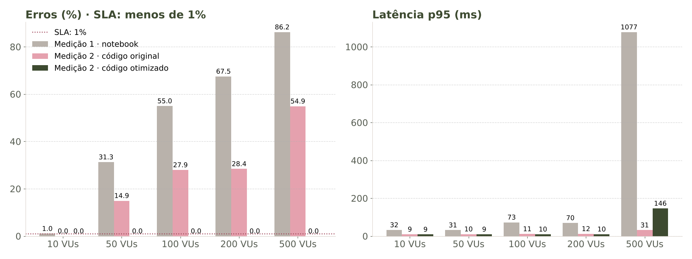
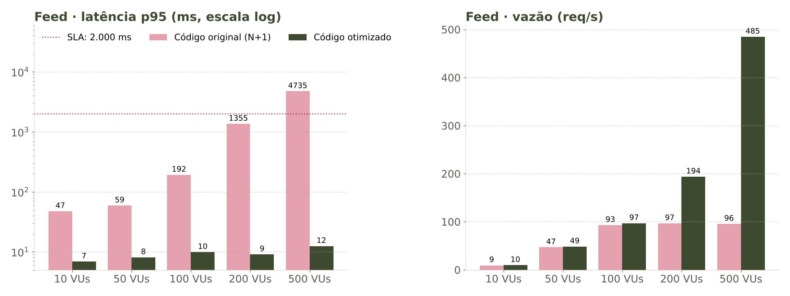

## Como os testes foram feitos

- **Ferramenta:** k6. Todos os serviços usam o mesmo perfil de carga ([`comum.js`](comum.js)).
- **Concorrência:** 10, 50, 100, 200 e 500 usuários virtuais (VUs), com 10 s de subida e 40 s parado em cada patamar.
  Cada VU faz uma requisição, espera 1 s e repete.
- **Latência:** tempo médio (`http_req_duration`), com p95 e p99. **Vazão:** requisições por segundo em cada patamar.
- **SLA:** RNF002 (p95 abaixo de 2 s) e RNF003 (menos de 1% de erros). **Limite de concorrência:** o maior patamar em que o SLA ainda vale.
- **Massa de dados:** [`massa-de-dados.sql`](massa-de-dados.sql) (2000 estudantes e 50 eventos) e, para o feed,
  [`massa-feed.sql`](massa-feed.sql) (100 postagens com 3 comentários cada; com a carga inicial, 103 postagens).
- **Gráficos:** [`graficos.py`](graficos.py).

### Configuração das máquinas e containers

| Item | Ambiente A (medição 1) | Ambiente B (medição 2) |
| --- | --- | --- |
| Máquina | Notebook i5-12450H, 8 GB de RAM, Windows 11 | Máquina virtual Linux na nuvem, 4 vCPUs, 15 GB de RAM |
| Docker | Docker Desktop | Docker Engine 29 |
| Containers | `unilink-mysql`: MySQL 8.0 · `unilink-backend`: Java 21 (eclipse-temurin:21-jre), Spring Boot 3.5 | os mesmos |
| Pool de conexões | HikariCP padrão (10) | original: 10 · otimizado: 20 |
| Gerador de carga | k6 na mesma máquina, em `http://localhost:8080` | k6 (imagem `grafana/k6`) na mesma máquina |

Em cada rodada o banco foi recriado do zero e as massas de dados foram carregadas antes dos testes.

### Arquivos com o código fonte da medição

[`comum.js`](comum.js) · [`login.js`](login.js) · [`eventos.js`](eventos.js) · [`presenca.js`](presenca.js) · [`feed.js`](feed.js) ·
[`massa-de-dados.sql`](massa-de-dados.sql) · [`massa-feed.sql`](massa-feed.sql) · [`rodar-testes.bat`](rodar-testes.bat) (Windows) ·
[`rodar-testes.sh`](rodar-testes.sh) (Linux) · [`graficos.py`](graficos.py)

---

## Serviço 1 · Login

- **Endpoint:** `POST /api/login` (UC02) · **Tipo de operação:** leitura
- **Arquivos envolvidos:** [`EstudanteController.java`](../backend/src/main/java/br/unirio/unilink/controller/EstudanteController.java) · [`EstudanteService.java`](../backend/src/main/java/br/unirio/unilink/service/EstudanteService.java) · [`Senhas.java`](../backend/src/main/java/br/unirio/unilink/service/Senhas.java) · [`EstudanteRepository.java`](../backend/src/main/java/br/unirio/unilink/repository/EstudanteRepository.java)
- **Código da medição:** [`login.js`](login.js)

### Medição 1

- **Data:** 07/11/2026 · notebook (ambiente A) · código original
- **Requisições:** 42941 · **Limite de concorrência no SLA:** o SLA valeu em todos os patamares, até **500 VUs**

| VUs | Latência média (ms) | p95 (ms) | Vazão (req/s) | Erros (%) | SLA |
| --- | --- | --- | --- | --- | --- |
| 10 | 9.72 | 12.98 | 9.6 | 0.00 | ✅ |
| 50 | 5.87 | 7.66 | 48.5 | 0.00 | ✅ |
| 100 | 5.30 | 7.81 | 97.0 | 0.00 | ✅ |
| 200 | 5.89 | 12.07 | 193.3 | 0.00 | ✅ |
| 500 | 5.90 | 8.79 | 484.9 | 0.00 | ✅ |

Gráficos da medição 1: publicados na página da 1ª entrega (repositório separado).

### Medição 2

**Código original** (14/11/2026, ambiente B, linha de base no mesmo ambiente):

- **Requisições:** 43115 · **Limite de concorrência no SLA:** o SLA valeu em todos os patamares, até **500 VUs**

| VUs | Latência média (ms) | p95 (ms) | Vazão (req/s) | Erros (%) | SLA |
| --- | --- | --- | --- | --- | --- |
| 10 | 5.11 | 6.68 | 9.7 | 0.00 | ✅ |
| 50 | 2.99 | 4.69 | 48.8 | 0.00 | ✅ |
| 100 | 2.78 | 6.07 | 97.3 | 0.00 | ✅ |
| 200 | 2.09 | 3.83 | 194.4 | 0.00 | ✅ |
| 500 | 1.77 | 3.57 | 486.6 | 0.00 | ✅ |

**Código otimizado** (14/11/2026, ambiente B):

- **Requisições:** 43115 · **Limite de concorrência no SLA:** o SLA valeu em todos os patamares, até **500 VUs**

| VUs | Latência média (ms) | p95 (ms) | Vazão (req/s) | Erros (%) | SLA |
| --- | --- | --- | --- | --- | --- |
| 10 | 5.03 | 6.35 | 9.7 | 0.00 | ✅ |
| 50 | 3.20 | 5.02 | 48.8 | 0.00 | ✅ |
| 100 | 2.52 | 4.52 | 97.3 | 0.00 | ✅ |
| 200 | 2.10 | 3.64 | 194.4 | 0.00 | ✅ |
| 500 | 1.73 | 3.22 | 486.5 | 0.00 | ✅ |

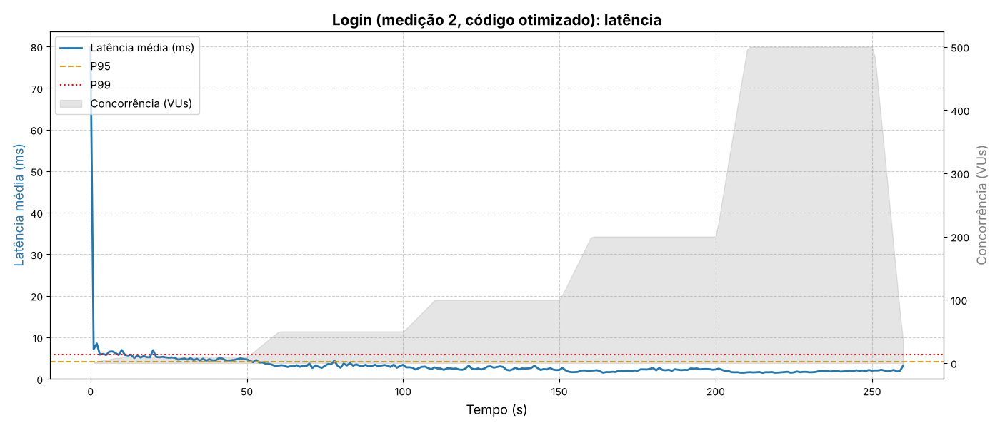
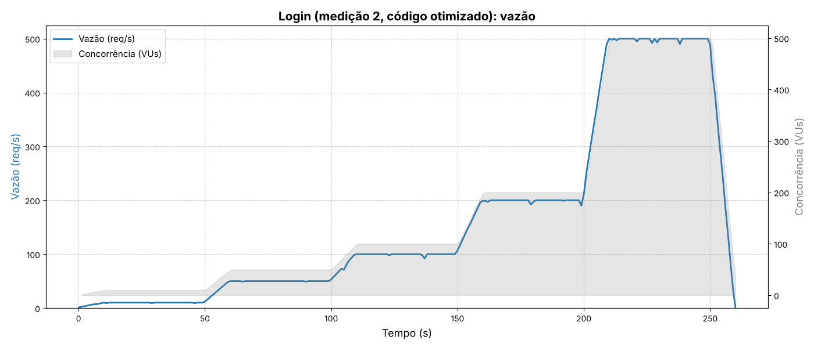


### Comparação

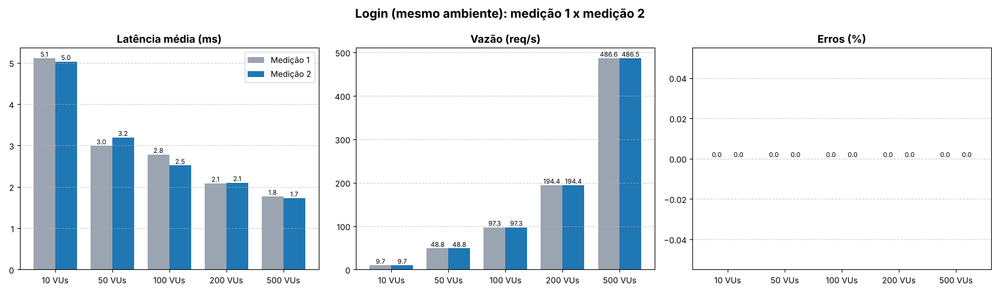
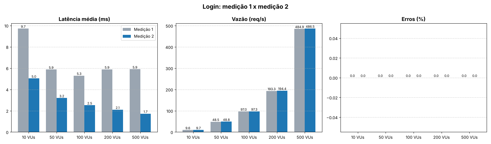

**Melhorias/otimizações:** nenhuma mudança específica; só o pool de conexões, que vale para todos
([`application.properties`](../backend/src/main/resources/application.properties)). Sem diferença mensurável: o login já respondia em poucos milissegundos.

---

## Serviço 2 · Agenda de eventos

- **Endpoint:** `GET /api/eventos?email=` (UC06) · **Tipo de operação:** leitura
- **Arquivos envolvidos:** [`EventoController.java`](../backend/src/main/java/br/unirio/unilink/controller/EventoController.java) · [`EventoService.java`](../backend/src/main/java/br/unirio/unilink/service/EventoService.java) · [`EventoRepository.java`](../backend/src/main/java/br/unirio/unilink/repository/EventoRepository.java) · [`01-schema.sql`](../database/01-schema.sql)
- **Código da medição:** [`eventos.js`](eventos.js)

### Medição 1

- **Data:** 07/11/2026 · notebook (ambiente A) · código original
- **Requisições:** 42799 · **Limite de concorrência no SLA:** o SLA valeu em todos os patamares, até **500 VUs**

| VUs | Latência média (ms) | p95 (ms) | Vazão (req/s) | Erros (%) | SLA |
| --- | --- | --- | --- | --- | --- |
| 10 | 6.63 | 8.58 | 9.7 | 0.00 | ✅ |
| 50 | 6.21 | 8.96 | 48.5 | 0.00 | ✅ |
| 100 | 8.18 | 14.32 | 96.7 | 0.00 | ✅ |
| 200 | 7.99 | 14.23 | 193.4 | 0.00 | ✅ |
| 500 | 10.27 | 22.39 | 483.8 | 0.00 | ✅ |

Gráficos da medição 1: publicados na página da 1ª entrega (repositório separado).

### Medição 2

**Código original** (14/11/2026, ambiente B, linha de base no mesmo ambiente):

- **Requisições:** 43099 · **Limite de concorrência no SLA:** o SLA valeu em todos os patamares, até **500 VUs**

| VUs | Latência média (ms) | p95 (ms) | Vazão (req/s) | Erros (%) | SLA |
| --- | --- | --- | --- | --- | --- |
| 10 | 3.41 | 4.36 | 9.7 | 0.00 | ✅ |
| 50 | 2.92 | 5.13 | 48.8 | 0.00 | ✅ |
| 100 | 2.96 | 5.12 | 97.3 | 0.00 | ✅ |
| 200 | 2.73 | 5.22 | 194.6 | 0.00 | ✅ |
| 500 | 2.19 | 4.01 | 486.2 | 0.00 | ✅ |

**Código otimizado** (14/11/2026, ambiente B):

- **Requisições:** 43085 · **Limite de concorrência no SLA:** o SLA valeu em todos os patamares, até **500 VUs**

| VUs | Latência média (ms) | p95 (ms) | Vazão (req/s) | Erros (%) | SLA |
| --- | --- | --- | --- | --- | --- |
| 10 | 3.53 | 4.46 | 9.7 | 0.00 | ✅ |
| 50 | 3.03 | 5.28 | 48.8 | 0.00 | ✅ |
| 100 | 2.90 | 4.95 | 97.3 | 0.00 | ✅ |
| 200 | 2.97 | 5.46 | 194.6 | 0.00 | ✅ |
| 500 | 2.43 | 4.47 | 486.1 | 0.00 | ✅ |

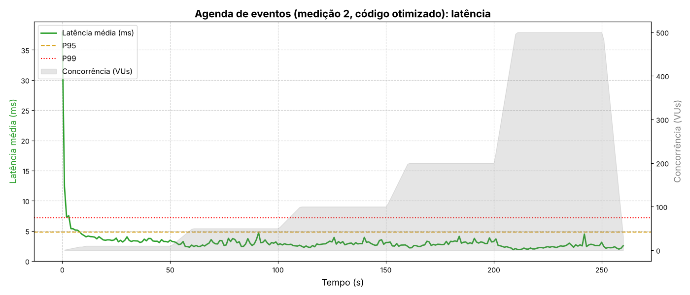
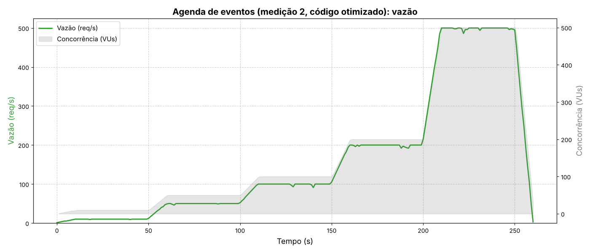


### Comparação

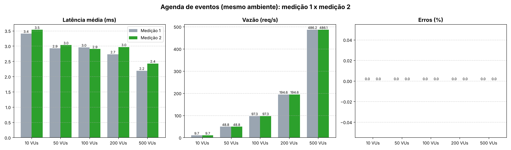
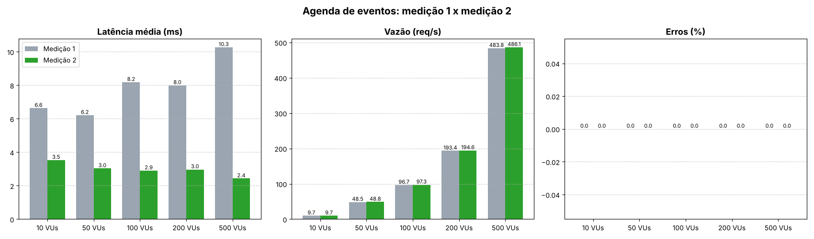

**Melhorias/otimizações:**

- O `EXISTS` executado para cada evento virou um `LEFT JOIN` com `presenca_evento` ([`EventoRepository.java`](../backend/src/main/java/br/unirio/unilink/repository/EventoRepository.java)).
- Índice `idx_evento_data` em `evento(data_hora_evento)`, a ordenação da agenda ([`01-schema.sql`](../database/01-schema.sql)).
- Pool de conexões ([`application.properties`](../backend/src/main/resources/application.properties)).

Resultado: sem diferença mensurável com 50 eventos (p95 entre 4 e 5,5 ms nas duas versões). A mudança deve aparecer com mais eventos.

---

## Serviço 3 · Confirmar presença

- **Endpoint:** `POST /api/eventos/{id}/presenca` (UC06) · **Tipo de operação:** inserção e atualização, na mesma transação
- **Arquivos envolvidos:** [`EventoController.java`](../backend/src/main/java/br/unirio/unilink/controller/EventoController.java) · [`EventoService.java`](../backend/src/main/java/br/unirio/unilink/service/EventoService.java) · [`EventoRepository.java`](../backend/src/main/java/br/unirio/unilink/repository/EventoRepository.java) · [`Validacao.java`](../backend/src/main/java/br/unirio/unilink/service/Validacao.java) · [`01-schema.sql`](../database/01-schema.sql)
- **Código da medição:** [`presenca.js`](presenca.js)

### Medição 1

- **Data:** 07/11/2026 · notebook (ambiente A) · código original
- **Requisições:** 35716 · **Limite de concorrência no SLA:** o SLA já não vale no primeiro patamar (10 VUs)

| VUs | Latência média (ms) | p95 (ms) | Vazão (req/s) | Erros (%) | SLA |
| --- | --- | --- | --- | --- | --- |
| 10 | 23.13 | 32.20 | 9.5 | 1.02 | ❌ |
| 50 | 18.62 | 31.49 | 48.0 | 31.27 | ❌ |
| 100 | 39.93 | 72.81 | 93.7 | 54.97 | ❌ |
| 200 | 33.54 | 69.54 | 188.0 | 67.48 | ❌ |
| 500 | 439.40 | 1077.32 | 328.0 | 86.19 | ❌ |

Gráficos da medição 1: publicados na página da 1ª entrega (repositório separado).

### Medição 2

**Código original** (14/11/2026, ambiente B, linha de base no mesmo ambiente):

- **Requisições:** 42790 · **Limite de concorrência no SLA:** **10 VUs**; com 50 VUs o SLA deixa de valer

| VUs | Latência média (ms) | p95 (ms) | Vazão (req/s) | Erros (%) | SLA |
| --- | --- | --- | --- | --- | --- |
| 10 | 7.76 | 9.30 | 9.7 | 0.00 | ✅ |
| 50 | 6.76 | 10.38 | 48.5 | 14.95 | ❌ |
| 100 | 6.58 | 11.16 | 97.0 | 27.94 | ❌ |
| 200 | 6.46 | 11.79 | 193.4 | 28.40 | ❌ |
| 500 | 11.98 | 31.41 | 481.2 | 54.88 | ❌ |

**Código otimizado** (14/11/2026, ambiente B):

- **Requisições:** 41987 · **Limite de concorrência no SLA:** o SLA valeu em todos os patamares, até **500 VUs**

| VUs | Latência média (ms) | p95 (ms) | Vazão (req/s) | Erros (%) | SLA |
| --- | --- | --- | --- | --- | --- |
| 10 | 7.13 | 8.60 | 9.7 | 0.00 | ✅ |
| 50 | 5.97 | 9.15 | 48.5 | 0.00 | ✅ |
| 100 | 5.48 | 9.55 | 97.0 | 0.00 | ✅ |
| 200 | 5.11 | 9.84 | 194.1 | 0.00 | ✅ |
| 500 | 54.80 | 146.10 | 462.3 | 0.00 | ✅ |

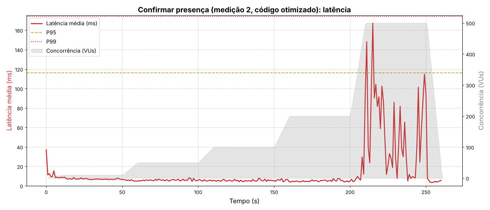
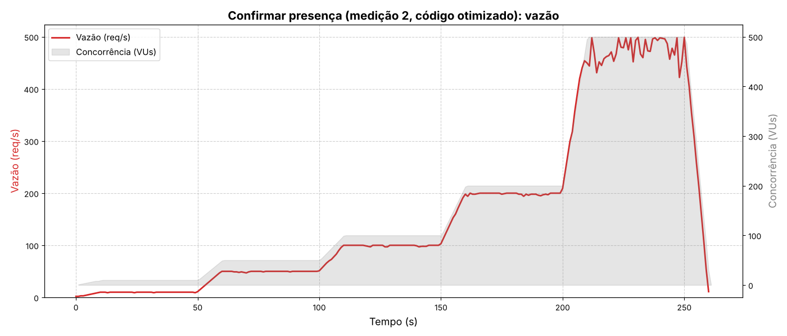
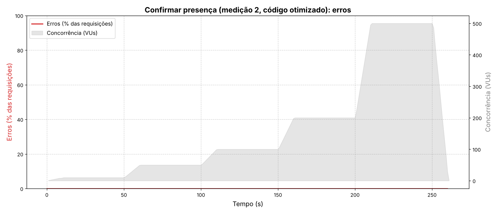

### Comparação

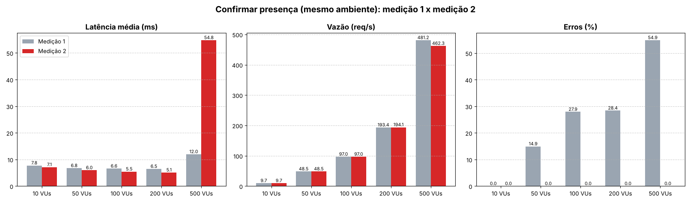
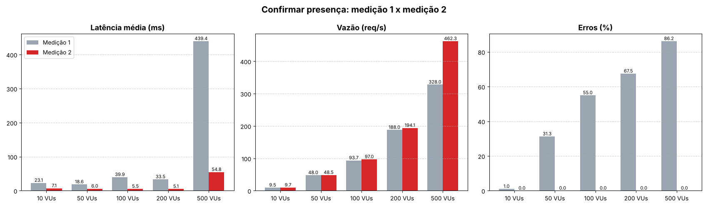

**Melhorias/otimizações:**

- **Fim do deadlock:** antes, o `INSERT` em `presenca_evento` vinha primeiro (a chave estrangeira trava a linha do evento para leitura)
  e o `UPDATE` do contador depois (pede a mesma linha para escrita). Agora o `UPDATE` vem primeiro e já trava a linha para escrita:
  quem chega depois espera na fila. Deadlocks no log do back-end: **34.470 → 0**.
- **Menos idas ao banco (4 → 3):** o `WHERE` do `UPDATE` confere se o evento existe e ainda não aconteceu, e a chave estrangeira do `INSERT`
  confere se o estudante existe. Sumiram as consultas separadas `estudantes.existe` e `buscar` antes de gravar.
- Se a presença for repetida, a exceção desfaz a transação inteira, inclusive o +1 do contador. Conferido no fim do teste:
  `qtd_confirmados` = número de linhas em `presenca_evento` (2000 em cada evento).
- Arquivos modificados: [`EventoService.java`](../backend/src/main/java/br/unirio/unilink/service/EventoService.java), [`EventoRepository.java`](../backend/src/main/java/br/unirio/unilink/repository/EventoRepository.java), [`Validacao.java`](../backend/src/main/java/br/unirio/unilink/service/Validacao.java).

Com 500 VUs a latência subiu (p95 de 31 para 146 ms), porque os pedidos agora esperam a vez em vez de falhar; continua muito abaixo de 2 s.

---

## Serviço 4 · Feed (incluído na medição 2)

- **Endpoint:** `GET /api/postagens` (UC08) · **Tipo de operação:** leitura (postagens com os comentários)
- **Arquivos envolvidos:** [`PostagemController.java`](../backend/src/main/java/br/unirio/unilink/controller/PostagemController.java) · [`PostagemService.java`](../backend/src/main/java/br/unirio/unilink/service/PostagemService.java) · [`PostagemRepository.java`](../backend/src/main/java/br/unirio/unilink/repository/PostagemRepository.java)
- **Código da medição:** [`feed.js`](feed.js) e [`massa-feed.sql`](massa-feed.sql)

### Medição 2

**Código original** (14/11/2026, ambiente B, linha de base no mesmo ambiente):

- **Requisições:** 18131 · **Limite de concorrência no SLA:** **200 VUs**; com 500 VUs o SLA deixa de valer

| VUs | Latência média (ms) | p95 (ms) | Vazão (req/s) | Erros (%) | SLA |
| --- | --- | --- | --- | --- | --- |
| 10 | 33.89 | 47.43 | 9.4 | 0.00 | ✅ |
| 50 | 39.04 | 58.97 | 46.8 | 0.00 | ✅ |
| 100 | 69.36 | 191.58 | 93.1 | 0.00 | ✅ |
| 200 | 959.61 | 1355.05 | 96.8 | 0.00 | ✅ |
| 500 | 3972.75 | 4734.54 | 95.7 | 0.00 | ❌ |

**Código otimizado** (14/11/2026, ambiente B):

- **Requisições:** 42959 · **Limite de concorrência no SLA:** o SLA valeu em todos os patamares, até **500 VUs**

| VUs | Latência média (ms) | p95 (ms) | Vazão (req/s) | Erros (%) | SLA |
| --- | --- | --- | --- | --- | --- |
| 10 | 5.32 | 6.85 | 9.7 | 0.00 | ✅ |
| 50 | 5.39 | 8.09 | 48.6 | 0.00 | ✅ |
| 100 | 5.74 | 9.87 | 97.0 | 0.00 | ✅ |
| 200 | 5.41 | 9.05 | 193.9 | 0.00 | ✅ |
| 500 | 6.14 | 12.46 | 484.9 | 0.00 | ✅ |

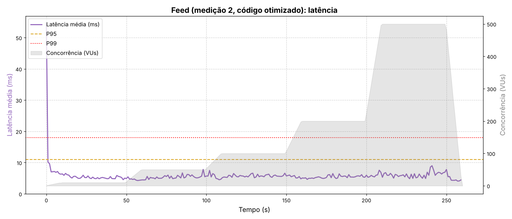
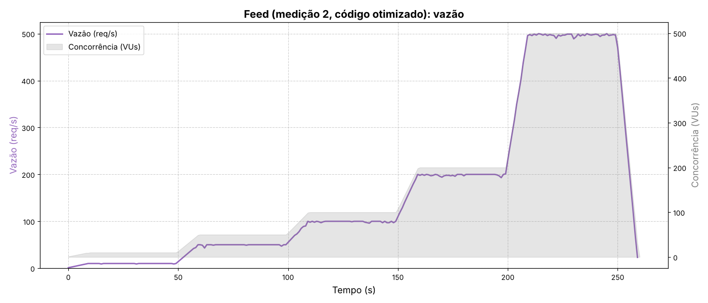
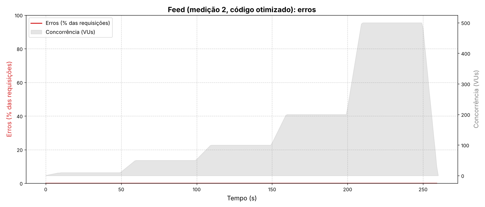

### Comparação

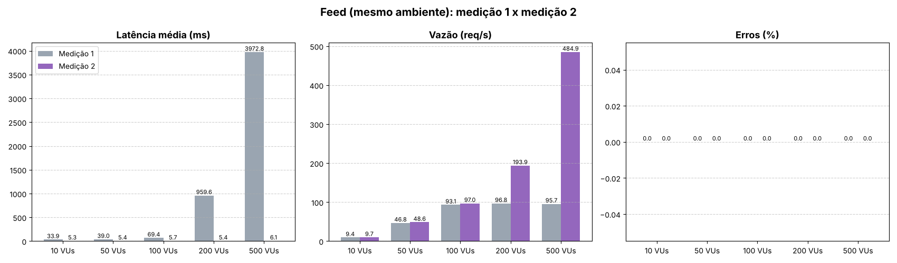

**Melhorias/otimizações:**

- **Problema N+1:** o feed fazia 1 consulta de postagens e mais 1 consulta de comentários **para cada postagem** (104 consultas por pedido com 103 postagens).
  Agora são 2 consultas: postagens e todos os comentários, agrupados por postagem em Java.
- Arquivos modificados: [`PostagemRepository.java`](../backend/src/main/java/br/unirio/unilink/repository/PostagemRepository.java), [`PostagemService.java`](../backend/src/main/java/br/unirio/unilink/service/PostagemService.java).

---

## Pool de conexões (todos os serviços)

`spring.datasource.hikari.maximum-pool-size=20` e `minimum-idle=20` em
[`application.properties`](../backend/src/main/resources/application.properties): 20 conexões já abertas desde o início (o padrão era 10).

## Como rodar

Precisa do Docker Desktop, do k6 e do Python com o matplotlib. No Windows, uma vez só:
`winget install k6 --source winget`, `winget install Python.Python.3.12` e, num cmd novo, `pip install matplotlib`.

1. Na pasta do projeto, recrie o banco e ligue o sistema: `docker compose down -v` e `docker compose up -d --build`.
2. No **cmd**, na pasta do projeto, carregue as massas de dados:

   ```
   docker compose exec -T mysql mysql -uunilink -punilink unilink_db < testes-de-carga\massa-de-dados.sql
   docker compose exec -T mysql mysql -uunilink -punilink unilink_db < testes-de-carga\massa-feed.sql
   ```

3. No cmd, na pasta `testes-de-carga`: `rodar-testes.bat 2` (no Linux: `./rodar-testes.sh 2`).

O teste de presença grava no banco, e o mesmo estudante não confirma duas vezes o mesmo evento: para repetir, recrie o banco (passo 1).
Os CSVs brutos (`resultados/*/bruto`) são grandes e não vão para o repositório.
